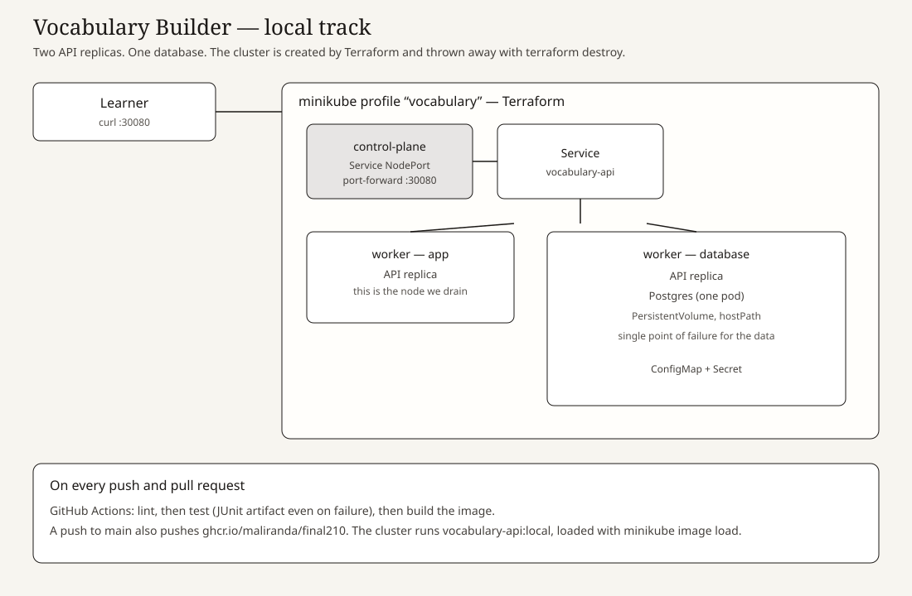

# Vocabulary Builder

Learners keep a personal word list: they add a term, read it back, and mark it learned. The web application in this repository is from my earlier web-programming projects (Projects 3–5: the React UI, the Zustand store, and the optional Firebase sync). That UI is still here, and how to run it is in [docs/ORIGINAL_APP.md](docs/ORIGINAL_APP.md).

This course deploys the part the business actually loses when the service is down: the word list. I trimmed that to one API and one Postgres table. Word lists and practice sessions stay in the old UI. They are not part of this deployment.

## Who it is for

A student studying a language. They add words while reading, look them up again later, and mark the ones they know before a quiz.

## What is down for an hour

The list is the product. For that hour nobody can add a word or check one. The study session they sat down for does not happen, and whatever they meant to save is gone until the service is back. That is why the API runs as two replicas on two nodes, and why a dead database has to take the pods out of the Service instead of serving errors at random.

## Operations this deployment implements

1. Add a word — `POST /api/words`
2. List words — `GET /api/words`
3. Mark a word new or learned — `PATCH /api/words/:id` with `{"masteryLevel": 1}` or `{"masteryLevel": 2}`

`GET /health` reports whether this process can reach the database.

## Entities

| Entity | Where it lives now |
| --- | --- |
| Word (`term`, `definition`, `masteryLevel`) | `words` table. This is the one the cluster runs. |
| Word list | Original React app only. Not deployed here. |
| Practice session | Original React app only. Not deployed here. |

## Track

Local. A multi-node [kind](https://kind.sigs.k8s.io/) cluster on this machine, created by Terraform. I am not using AWS. A cloud load balancer would cost money for the same demonstration: two backends, health checks, and traffic that keeps flowing when one backend is removed. Kind does that on a laptop, and I can tear the cluster down with `terraform destroy`.

## Architecture



The same picture, as text: GitHub Actions lints, tests, and builds the image, and pushes it to GHCR on `main`. Terraform creates a kind cluster with one control-plane and two workers. The API Deployment has two replicas, spread across those workers, behind a NodePort. Postgres is one pod on the database worker, with a PersistentVolume. The API reads its configuration from a ConfigMap and the database password from a Secret.

## Run it on a clean machine

You need Docker, Node.js 22, Terraform 1.5 or newer, and kubectl. Terraform's kind provider creates the cluster, so a separate kind binary is not required. `scripts/deploy.sh` imports the image into each node with `ctr`, because a kind CLI that is older than the cluster cannot load images into it.

### App and database, one command

From the repository root:

```bash
docker compose up --build
```

The API listens on `http://127.0.0.1:8088`. The container still uses port 8080. The host port is 8088 because 8080 is often already taken on a laptop. Postgres is published on `127.0.0.1:5433` so it does not collide with a Postgres already installed on the laptop. The database password in `docker-compose.yml` is the local default `vocabulary`. It is not a credential for anything outside this compose file. The cluster password is different and is not committed. See the [runbook](docs/RUNBOOK.md).

Check the three operations:

```bash
./scripts/smoke.sh http://127.0.0.1:8088
```

Stop it with `docker compose down`. Add `-v` to drop the database volume too.

### Tests

```bash
docker compose up -d db
cd api
npm ci
PGHOST=127.0.0.1 PGPORT=5433 PGUSER=vocabulary PGPASSWORD=vocabulary PGDATABASE=vocabulary npm test
```

GitHub Actions starts its own Postgres on port 5432. You do not need compose for the pipeline.

### Cluster

```bash
cd terraform
terraform init
terraform apply
cd ..
./scripts/deploy.sh
./scripts/smoke.sh http://127.0.0.1:30080
```

`scripts/deploy.sh` builds `vocabulary-api:local`, loads it into the kind cluster, writes a database password to `.secrets/db-password` (gitignored), and applies the manifests. Run it again after a code change.

Details of deploy, rollback, and the first things to check are in [docs/RUNBOOK.md](docs/RUNBOOK.md). The product page is [docs/PRODUCT.md](docs/PRODUCT.md). The evidence write-up is [docs/WRITEUP.md](docs/WRITEUP.md).

## Configuration

Nothing the process needs is baked into the image. `PORT`, `APP_VERSION`, `PGHOST`, `PGPORT`, `PGUSER`, `PGPASSWORD`, and `PGDATABASE` come from the environment. Compose sets them for local runs. Kubernetes sets them from the ConfigMap `vocabulary-config` and the Secret `vocabulary-db`.

## Pipeline

`.github/workflows/ci.yml` runs on every push and pull request. Lint runs first. Tests run only after lint passes, against a Postgres service container, and the JUnit report is uploaded even when the tests fail. The image is built only after the tests pass. It is pushed to `ghcr.io/maliranda/final210` only on a push to `main`.

## Original interface

The React app is the interface from the earlier course. It stores words in the browser, and in Firebase when that is configured. It does not call this API. Wiring it up would be application work, and this submission is the infrastructure under the word list.

```bash
npm install
npm run dev
```
